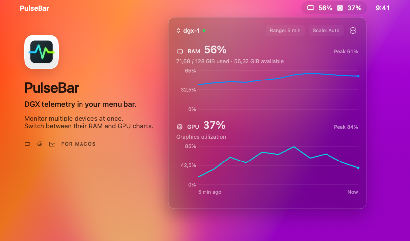

<p align="center">
  
</p>

[](https://github.com/amer8/pulsebar/actions/workflows/quality.yml)

`PulseBar` is an unofficial macOS menu bar monitor for telemetry exposed by the DGX Dashboard web app on NVIDIA DGX Spark and compatible NVIDIA GB10-based OEM systems. It signs in to each dashboard over verified SSH and follows its live RAM and GPU event stream. Choose a device at the top of the telemetry panel to see its charts and menu bar readings while the others keep reporting.

## Requirements

- A Mac with Apple silicon running macOS 13 Ventura or newer.
- An SSH alias for the device in `~/.ssh/config`, a trusted host key, and noninteractive SSH login.
- A dashboard listening on the device’s loopback interface (default port 11000) and `/usr/bin/curl` on the device.
- Valid dashboard credentials.

## Compatible Systems

PulseBar targets the local DGX Dashboard rather than a specific enclosure. Known compatible NVIDIA GB10 variants are:

- [NVIDIA DGX Spark](https://www.nvidia.com/en-us/products/workstations/dgx-spark/)
- [Acer Veriton GN100 AI Mini Workstation](https://www.acer.com/us-en/desktops-and-all-in-ones/veriton-workstations/veriton-gn100-ai-mini-workstation)
- [ASUS Ascent GX10](https://www.asus.com/us/networking-iot-servers/desktop-ai-supercomputer/ultra-small-ai-supercomputers/asus-ascent-gx10/)
- [Dell Pro Max with GB10](https://www.dell.com/en-us/shop/desktop-computers/spd/dellpromaxwithgb10fcm1253)
- [GIGABYTE AI TOP ATOM](https://www.gigabyte.com/AI-TOP-PC/GIGABYTE-AI-TOP-ATOM)
- [HP ZGX Nano AI Station](https://www.hp.com/us-en/workstations/zgx-nano-ai-station.html)
- [Lenovo ThinkStation PGX](https://www.lenovo.com/us/en/p/workstations/thinkstation-p-series/lenovo-thinkstation-pgx-sff/len102s0023)
- [MSI EdgeXpert MS-C931](https://ipc.msi.com/product_detail/Industrial-Computer-Box-PC/AI-Supercomputer/EdgeXpert-MS-C931)

## Set up verified SSH

Choose **+ Add new** in **Preferences → Devices** or in the telemetry panel. **Choose a device** lists SSH aliases from `~/.ssh/config` and its included files that you haven’t added yet. If your device is missing, choose **Set up a device in NVIDIA Sync…** and return to PulseBar to see the refreshed list. If the Dashboard uses a custom port, enter it under **Settings → DGX Dashboard port** before selecting the device. Selecting an alias starts verification immediately. PulseBar opens its own SSH connection using the saved alias and adds the device once its Dashboard responds.

For a new host key, get the expected SHA256 fingerprint from the device’s console or its administrator. Paste that independent value into **Verify your device** and choose **Verify and Connect**. A changed key stops setup. Verify any rotation with your administrator before updating your SSH trust store.

SSH login must work with a key or SSH agent. If your SSH account has no authorized key for this Mac, ask its administrator to install your SSH **public** key for that account. You can also manage the connection yourself in `~/.ssh/config` using an entry such as

```sshconfig
Host dgx
    HostName spark.local
    User your-dgx-user
    HostKeyAlias dgx
```

PulseBar checks the host key under the selected alias. A key saved only under `spark.local` may need to be verified again for `dgx`.

PulseBar reads telemetry over verified SSH. To use the dashboard in a browser, choose **Open NVIDIA Sync** in the telemetry panel’s **⋯** menu. Select your device in NVIDIA Sync and open its dashboard. The DGX system update banner also opens NVIDIA Sync.

## Installation

Install the Homebrew cask from the [amer8 Homebrew Tap](https://github.com/amer8/homebrew-tap):

```bash
brew install --cask amer8/tap/pulsebar
```

Alternatively, download the latest [GitHub Release](https://github.com/amer8/pulsebar/releases) DMG file, open it, and drag `PulseBar.app` to Applications.

Signed direct-download builds can check for app updates from the PulseBar menu.

Choose **About PulseBar** from the telemetry panel’s actions menu (···) to see the app
version, build, release date, and project links.

## First Run

1. Launch PulseBar.
2. PulseBar opens **Preferences → Devices** the first time it needs an SSH alias. You can return there from the menu bar item’s **Preferences…** action.
3. Choose your device. Once verification succeeds, PulseBar restores an available saved Dashboard session or prompts you to sign in for that device. When upgrading from a port-only configuration, sign in once for the new profile.
4. After sign-in, PulseBar stores the returned token in Keychain and starts the telemetry stream unless reconnection is paused.
5. On later launches, PulseBar automatically restores sessions that Keychain allows it to read. If a device needs Keychain permission, select it in **Preferences → Devices** and choose **Restore Saved Session**. To forget that saved sign-in, choose **Settings → Remove Saved Session…**, check the device name, and click **Remove**.
   The Keychain prompt names the device, for example **PulseBar Dashboard – lab**. An entry created by an older build can still appear as **PulseBar.Dashboard**. To give that entry the device name, sign out of that device and sign back in once.
   After five consecutive telemetry failures, reconnection pauses for that alias and port, even
   after a restart. Choose **Reconnect** in the telemetry panel or **Preferences → Devices** to resume.

To monitor a second device, choose **+ Add new** in either device picker, then complete setup and sign-in. Both device pickers show the Dashboard username for each signed-in device. Choose a device in **Preferences → Devices** to manage its account, or in the telemetry panel to choose which device the charts and menu bar show. Both devices keep collecting readings while you switch. Signing out stops collection for that device only.

## Development

See [CONTRIBUTING.md](CONTRIBUTING.md) for source setup, local builds, the release process, and implementation details.

## License

PulseBar is released under the MIT License. See `LICENSE`.

## Legal Notice

PulseBar is an independent, unofficial project and is not affiliated with, sponsored by, endorsed by, or approved by NVIDIA Corporation. NVIDIA, NVIDIA Sync, DGX, DGX Spark, GB10, and DGX Dashboard are trademarks, registered trademarks, or product names of NVIDIA Corporation or its affiliates. Other company and product names are trademarks, registered trademarks, or product names of their respective owners. Their use here is solely to identify compatibility with a locally running dashboard and supported hardware.

## Privacy And Security

See [SECURITY.md](SECURITY.md) for privacy and security details.
